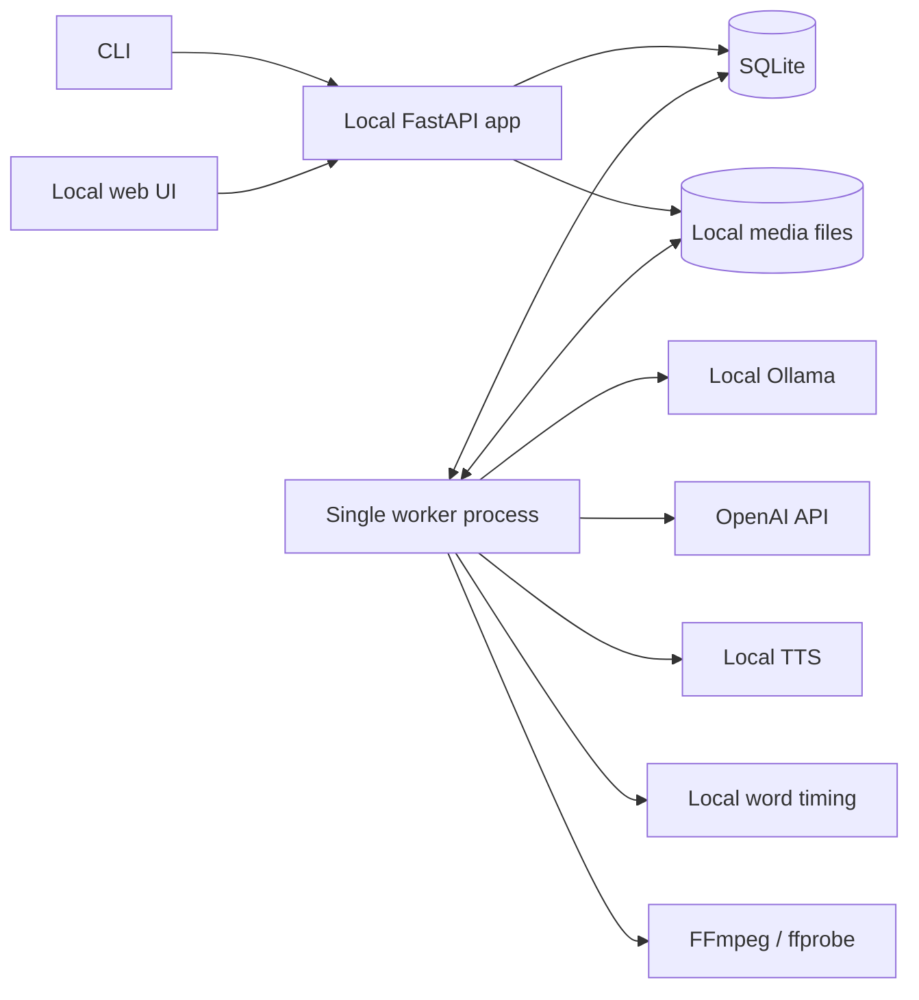

# Story video generator — MVP architecture proposal

**Status:** Approved by owner on 2026-11-13

**Date:** 2026-11-13

**Basis:** [Product requirements](product-requirements.md)

## 1. Architectural stance

Build one local Python application with a defined, restartable pipeline. The web UI and CLI are two ways to submit and inspect the same jobs. One worker process runs one generation job at a time. SQLite stores state; files store large media. Story writing, evaluation, revision, and posting copy use the selected Ollama or OpenAI models. Audio, timing, and rendering are explicit tools, not autonomous agents.



The app is intended for one machine and one user. There is no cloud deployment, broker, microservice, autonomous-agent framework, or account system in the MVP.

## 2. Main technology choices

| Concern | Recommendation | Reason and tradeoff |
| --- | --- | --- |
| Runtime | Python 3.11 in an isolated project environment; lock dependency versions before implementation | The Chatterbox project says it was developed and tested on Python 3.11, while the machine currently has Python 3.14. This reduces first-run compatibility risk, at the cost of managing another Python version. [Chatterbox README](https://github.com/resemble-ai/chatterbox/blob/master/README.md) |
| HTTP and web UI | FastAPI, server-rendered templates, a little plain JavaScript for progress polling and video preview | One Python stack for API and UI; no separate Node build. HTML complexity can grow if editing becomes richer. |
| CLI | Python standard-library `argparse`, calling the same loopback HTTP API as the web UI | One validation and job-submission path. The local app must be running before CLI commands are used; a standalone CLI would require a second lifecycle path. |
| Durable jobs | SQLite queue plus one dedicated worker **process** | Keeps long model and FFmpeg work out of HTTP requests. A single worker avoids CPU/GPU contention. More setup than an in-process task, but jobs survive web restarts. FastAPI warns that its lightweight background tasks are not suited to heavy computation. [FastAPI background-task guidance](https://fastapi.tiangolo.com/tutorial/background-tasks/) |
| State | Standard-library `sqlite3`, short transactions, versioned SQL migrations, WAL mode | Small, inspectable schema without an ORM or database server. WAL lets the UI read while the worker writes, though SQLite still has one writer at a time. [SQLite WAL documentation](https://www.sqlite.org/wal.html) |
| Story and evaluation | Selected Ollama or OpenAI model with Pydantic v2 validation, followed by deterministic application checks | Use structured responses, then validate the returned JSON with Pydantic. No agent framework is needed for a fixed sequence; schema validity alone cannot establish story quality. Store model name, prompt version, and evaluation reasons for each run. [Ollama structured outputs](https://docs.ollama.com/capabilities/structured-outputs), [OpenAI structured outputs](https://developers.openai.com/api/docs/guides/structured-outputs) |
| Narration | Local Chatterbox as the first engine to benchmark, using `samples/female_voice_reference.mp3` and `samples/male_voice_reference.mp3` | These user-supplied references match the female/male rule. Chatterbox is archived and unmaintained, so the exact model/version is a release gate, not an assumed production choice. [Chatterbox project status](https://github.com/resemble-ai/chatterbox/blob/master/README.md) |
| Word timing | Local `faster-whisper` on the **final** audio | It supports word timestamps; recognized text must be compared with the script before subtitle creation. A stronger aligner is an option only if timings fail acceptance checks. [faster-whisper documentation](https://github.com/SYSTRAN/faster-whisper) |
| Media | FFmpeg and ffprobe as subprocesses, with argument arrays and fixed filter templates | Mature tools for trim/loop/crop/mix/burn-in. Check exit status and inspect produced media. No arbitrary user text enters shell commands. [FFmpeg filters](https://www.ffmpeg.org/ffmpeg-filters.html) |

The repository currently contains the PRD, empty `requirements.txt`, and experimental `samples/`; none is a production implementation. Ollama, FFmpeg, and ffprobe are present on this Mac. Python 3.11 and the speech/app dependencies have not been verified here.

### Execution approaches considered

| Approach | Tradeoff | Decision |
| --- | --- | --- |
| Run generation inside a FastAPI background task | Least setup, but heavy work shares the web process and restart recovery is awkward | Rejected for this long-running media pipeline. |
| SQLite queue with one worker process | Small durable boundary and responsive UI; requires a launcher to supervise two processes | **Recommended** for the MVP. |
| Redis/Celery or hosted workflow service | Useful for many workers or machines, but adds infrastructure and operational cost | Defer until hosted scheduling or higher throughput is needed. |

## 3. Components and boundaries

1. **Application service:** validates run inputs, resolves saved defaults, chooses the random theme and clip, creates revisions, approves only the current revision, and exposes run status. The API calls it; the CLI calls the API.
2. **Pipeline worker:** claims one queued job transactionally, advances named stages, records attempts, and resumes or marks interrupted jobs after restart. Each stage takes explicit inputs and returns validated outputs or a typed failure.
3. **Story module:** builds the plan and script, asks the evaluation role for rubric feedback, applies deterministic constraints (required fields, requested perspective, word budget), and revises at most twice by default. First person is the validated phase-one preset. A failed rubric ends in a flagged story draft before media work.
4. **Narration module:** chooses voice from stored narrator identity, generates WAV, measures its actual duration, and checks intelligibility/clipping/duration. A script revision invalidates narration and all later artifacts.
5. **Timing module:** transcribes final WAV into word timestamps, compares transcription with script, then creates five-to-seven-word caption cues with shorter groups at natural breaks. Timing data is independent of position/style.
6. **Renderer:** validates uploaded clips with ffprobe, mutes clip audio, fills a 9:16 frame, and burns captions in using a generated subtitle file. A clip longer than the narration is trimmed; a shorter clip is looped and its last repeat trimmed. The final MP4 ends with the final story audio, apart from unavoidable frame/codec rounding. ffprobe verifies the result before it is offered for review.
7. **Posting-copy module:** creates and validates one shared text set after the story is stable. Copy is editable in review; there is no upload integration in the MVP.
8. **Local web layer:** settings, clip library, run status, video preview, story notes, subtitle-position notes, approval, and download. Long-running work is never performed inside an HTTP request.

Keep the dependency direction simple: `web/cli → application service → persistence/pipeline → Ollama or OpenAI/TTS/ASR/FFmpeg`. Model IDs are validated settings, frozen into each run's input JSON, and selected separately for writing, evaluation, and posting copy. Media stages should not know about HTTP or HTML. Avoid generic plugin interfaces until a second concrete engine is needed.

### Validation at each boundary

- **User/API input:** FastAPI uses Pydantic v2 models to validate field types, allowed themes, positive and bounded duration/speed, and free-text lengths before a run is stored. [FastAPI request validation](https://fastapi.tiangolo.com/tutorial/body/)
- **Ollama output:** Define small Pydantic models for story/plan (`script`, `summary`, explicit narrator identity), evaluation (criterion ratings, pass/fail, reasons), and one shared posting copy (title, caption, hashtags). Configure these models to forbid extra fields and use strict field validation; reject missing fields, invalid enums, empty text, and out-of-range ratings. Send the same model's JSON Schema to Ollama and parse its response with Pydantic; malformed output gets a bounded retry, then a visible stage failure. [Ollama structured outputs](https://docs.ollama.com/capabilities/structured-outputs), [Pydantic models](https://pydantic.dev/docs/validation/latest/concepts/models/)
- **Business rules:** Check the resolved perspective, approximate word budget, required first-person narration for the validated preset, allowed platform set, and plot-similarity guard separately from Pydantic shape checks. The evaluator's judgment is advisory within a bounded revision loop; human review remains the final quality gate.
- **Media output:** Validate voice-reference and uploaded-clip format with ffprobe, compare final-audio transcription with the script, and inspect rendered dimensions, streams, and audio/video end alignment before marking a stage complete.

Pydantic is already part of the proposed FastAPI stack. This uses it for data contracts, not as an agent framework. Do not persist or pass unvalidated model text to a downstream stage.

## 4. Job and revision behavior

- **Submission:** Resolve and validate all inputs once. Save the exact values, random seed, selected theme, selected clip ID, model identifiers, and prompt versions. Return a run ID immediately.
- **Execution:** The worker claims the oldest queued run with a short SQLite transaction. It writes each stage result to a temporary file, validates it, atomically promotes it into a revision directory, then records the completed stage. A crash leaves at most the current stage incomplete.
- **Recovery:** On restart, mark an abandoned active attempt as interrupted. Retain successful stage artifacts and requeue only the incomplete stage when the owner retries. Never silently approve or replace a prior output.
- **Story feedback:** Create a new revision carrying the note; rewrite the story, then rerun evaluation, narration, timing, render, and posting copy. Preserve the old preview in history, but only the current preview is approvable.
- **Subtitle-position feedback:** Create a new revision reusing the same script, audio, and word timing; regenerate styled captions and render only. Position is a constrained value in the layout model, not a raw FFmpeg expression from the user's note.
- **Approval:** Set `approved_revision_id` in one transaction only if that revision is current and reviewable. Final export points to immutable approved files. An unapproved revision cannot overwrite them.
- **Capacity:** The launcher holds a single-instance OS lock and supervises one worker process; a second launcher exits rather than starting another worker. One job at a time, a bounded queue, finite stage retries, and explicit failure reasons prevent concurrent model loads from exhausting memory.

## 5. Data model and file layout

Use SQLite for metadata, state, and small text; use local files for clips, WAV, caption timing, subtitle assets, and MP4. No binary media goes in SQLite.

| Table | Key fields | Purpose |
| --- | --- | --- |
| `settings` | `key`, `value_json`, `updated_at` | Single-user defaults and local preferences. Validate on read and write. |
| `clips` | `id`, relative path, SHA-256, duration, width, height, active flag | Uploaded library and source-media validation. Removing a clip deactivates it; existing revisions keep their reference. |
| `runs` | `id`, status, resolved-input JSON, seed, selected theme/clip ID, current revision ID, approved revision ID, timestamps, last error | One generation request and its lifecycle. |
| `revisions` | `id`, run ID, number, request type/note, parent ID, story text/summary, narrator identity, evaluation JSON, audio duration, subtitle placement, posting-copy JSON, artifact paths, timestamps | Story/video versions and review history; freeze a version once it awaits review. |
| `stage_attempts` | `id`, revision ID, stage, attempt number, status, start/end times, error code/message | Recovery and diagnostics without exposing raw stack traces in the UI. |

Place app data outside the Git repository, in the user's application-support directory. The user-facing background library lives in the Git-ignored project `background_videos/` folder; validated clips are copied into managed `clips/library/` storage so runs keep stable paths. Existing managed clips retain their paths. Use `runs/<run-id>/revisions/<n>/...` and a SQLite database in the app data directory. Store only managed relative paths in the database; resolve them under the app data root. Keep temporary files beside their destination so an atomic rename is possible. Back up the database and media directory together, and back up the project background library separately.

The database schema is intentionally small. Use SQL migrations checked into the repository and run them on startup. Use foreign keys and unique constraints for run/revision relationships, a single-current-revision invariant, and a unique stage attempt number per revision/stage.

## 6. Local API conventions

The web UI uses the same JSON API that the CLI calls. Keep endpoints under `/api/v1`; use IDs rather than filesystem paths. Return `202 Accepted` with a run/revision ID for operations that enqueue work. Return `409 Conflict` for stale approval or overlapping revision requests; `422` for invalid inputs; `404` for unknown IDs. Errors have stable machine-readable codes and human-readable messages. All timestamps use UTC in storage and are formatted locally in the UI.

| Route | Purpose |
| --- | --- |
| `GET/PUT /api/v1/settings` | Read and update validated defaults. |
| `GET/POST /api/v1/clips`, `DELETE /api/v1/clips/{id}` | List/upload/deactivate clips. |
| `GET/POST /api/v1/runs`, `GET /api/v1/runs/{id}` | List/start/inspect runs and stage status. Run lists include the current story title when generated. |
| `DELETE /api/v1/runs/{id}` | Explicitly remove a finished or failed run, its revisions, and generated artifacts; retain shared uploaded clips. |
| `GET /api/v1/runs/{id}/revisions/{n}` | Inspect one preview, evaluation, and posting copy. |
| `POST /api/v1/runs/{id}/revisions` | Submit a story or subtitle-position change request. |
| `PUT /api/v1/runs/{id}/revisions/{n}/posting-copy` | Edit the shared title, caption, and hashtags while the revision awaits review. Body is one posting-copy object. |
| `POST /api/v1/runs/{id}/retry` | Retry a failed or interrupted stage. |
| `POST /api/v1/runs/{id}/approve` | Approve the current revision, with its revision ID supplied for stale-request protection. |
| `GET /api/v1/runs/{id}/video` | Stream the current reviewable or approved MP4; use a separate download disposition for export. |

The posting-copy API now uses a single object rather than a platform-keyed map. Existing platform-keyed copy is projected as one object when read; stored historical JSON is left intact. Saved platform selections are ignored when reading older settings and are omitted from new settings and runs.

Use short polling for progress in the local UI; no WebSockets or event bus in phase one. Keep the OpenAPI schema generated by FastAPI as the API reference. Do not expose direct path or arbitrary command endpoints.

## 7. Security and data handling

- Bind the HTTP service to `127.0.0.1` only. Reject unexpected `Host` and browser `Origin` values; require JSON for state-changing API calls except media upload, and do not enable permissive CORS. No login is proposed while the app remains local and single-user. Revisit authentication before remote access or scheduled hosting.
- Validate uploaded media by size and by ffprobe inspection, not filename alone. Copy it into managed storage; reject unsupported or corrupt inputs. Never let API values form arbitrary filesystem paths or subprocess arguments.
- Bound free-text input lengths. Treat Ollama output as untrusted: parse, validate, and constrain story metadata, caption positioning, and posting copy before storing or rendering them.
- Keep model downloads, voice references, and videos local. Use the two user-supplied MP3s in `samples/` for the first benchmark; validate and copy them into managed local voice storage for production runs, leaving the sample originals untouched. Record their checksums and provenance, and confirm rights to use them before publishing. Avoid logging full scripts or media paths in routine logs; keep intentional story history in the database.
- Render into a temporary location and expose only validated files. Preserve approved revisions and make deletion explicit, not part of retries or routine cleanup.

## 8. Project structure

```text
story_teller/
  pyproject.toml                 # Python metadata and locked dependency input
  src/story_teller/
    app.py                      # FastAPI setup and local HTML routes
    api.py                      # /api/v1 request/response layer
    cli.py                      # argparse commands, loopback API client
    service.py                  # use cases and lifecycle rules
    worker.py                   # single-job worker and recovery
    pipeline.py                 # explicit stage order and invalidation
    story.py                    # Ollama prompts, output validation, rubric
    speech.py                   # local TTS and final-audio checks
    captions.py                 # local word timing and cue grouping
    render.py                   # FFmpeg/ffprobe calls and media checks
    storage.py                  # SQLite access and managed file paths
    migrations/                # versioned SQL
    templates/                 # server-rendered pages
    static/                    # small CSS/JS assets
  tests/
    unit/                      # deterministic decisions and validation
    integration/               # API, SQLite, fake model/media adapters
    fixtures/                  # tiny audio/video files and sample outputs
  docs/
    product-requirements.md
    architecture-proposal.md
  samples/                      # reference experiments; not imported by app
```

Files can be merged if the implementation stays small. The important boundaries are lifecycle rules, AI output validation, speech/timing, rendering, and persistence; the filenames are a starting map, not a mandate for one class per file.

## 9. Testing and verification

- **Unit tests:** input/default resolution, theme selection (fixed seed), story JSON validation and rubric pass/fail, retry bounds, caption grouping, revision invalidation, approval guards, and path confinement.
- **Integration tests:** SQLite migrations and worker restart/retry; HTTP status/error contracts; CLI against a local test server; media upload validation; FFmpeg with tiny fixtures to test crop, loop, trim, muted source audio, and audio/video end alignment.
- **Model contract tests:** captured Ollama outputs and a small owner-rated story set. Test that invalid or low-quality responses stop or revise correctly. The same local model may write and evaluate a story, so human approval remains the final quality gate.
- **End-to-end acceptance:** one complete story with a long landscape clip and one with a short clip; verify an MP4 can play, words and captions match, the ending follows the final audio within frame/codec tolerance, story-note revisions regenerate downstream artifacts, and position-only revisions preserve audio.
- **Visual/audio review:** listen to female and male examples and inspect captions at portrait size. Automated tests cannot establish natural narration or platform-safe placement.

Keep model-heavy tests outside the quick test suite. Lock a specific working model/version and record it with run metadata after the first benchmark; avoid network/model downloads in normal unit tests.

## 10. Local deployment and operations

- Provide one native setup path for Python 3.11, Ollama, FFmpeg, model downloads, and the two narrator voice references. A preflight command checks executables, model availability, free disk space, and write permissions before a run starts. Avoid Docker for the local MVP because it adds model-cache and Apple GPU integration work without helping this on-demand single-user deployment.
- A single local launcher starts FastAPI on loopback and the one worker process. The CLI connects to that server. The UI shows worker health and model availability; stopping the launcher does not delete jobs or media.
- Store app data under a configurable application-support directory, defaulting to the platform's user data location, not the repository. Keep configuration local; do not require cloud credentials.
- Log run/revision/stage IDs, durations, model identifiers, and errors. Never claim success until ffprobe and artifact checks pass. A failed run remains inspectable and retryable.
- For a future always-on service, retain the stage contracts and move the worker and database to hosted infrastructure only when scheduling and automatic publishing are in scope. No deployment infrastructure is needed now.

## 11. Owner-approved decisions

1. **Process model:** A local web server and one worker process; CLI commands call the running local API. The launcher must be active for CLI use.
2. **Storage:** Local SQLite plus files in an application-support directory, with no account/login while loopback-only. No automatic retention period is specified; approved outputs remain until explicitly removed.
3. **Speech baseline:** Chatterbox and faster-whisper are the first local candidates, subject to a full-length benchmark. Initial female and male references are present in `samples/`; their suitability still needs to be tested.
4. **Video defaults:** 1080 × 1920 H.264/AAC output, burned-in captions, and a 90 ±10-second *audio target*. The actual video ends with the final audio regardless of target-duration variation.

## 12. Risks and explicit limits

- Chatterbox is archived, and local model installation/performance on this machine is unverified. A benchmark may require a different local TTS engine without changing the pipeline contract.
- The current system Python is 3.14; using 3.11 introduces a separate environment but limits dependency risk for the initial TTS candidate.
- SQLite and one worker fit single-user, on-demand generation. Concurrent users or hosted scheduling would require a new job and access-control design.
- Story evaluation is a heuristic quality gate. It cannot establish likely views or retention without real post-performance data.
- Platform specifications and account/API policies must be rechecked before future automatic publishing. The MVP only exports media and copy.
